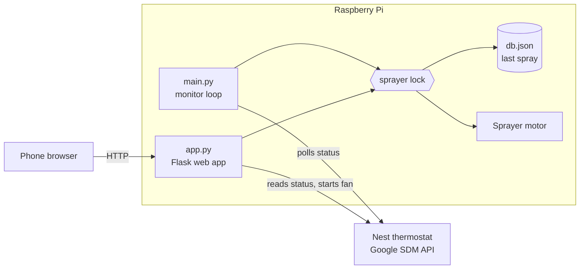

# Automatic HVAC Air Freshener

A Raspberry Pi that freshens a whole house using the air conditioning. It polls a Nest thermostat through Google's Smart Device Management API, and whenever the system is heating or cooling, it drives a motor that presses an air freshener can aimed at the air filter in the return duct. The running HVAC system then carries the scent through the house.

A small web page also lets you trigger a spray from your phone and check on the system. [hvac_front_end](https://github.com/kcmodev/hvac_front_end) is a separate React client for the same API.

## How it works

Two independent processes share the same hardware and spray history:



**The monitor** (`main.py`) decides when to spray automatically:

| Situation | Action | Next check |
| --- | --- | --- |
| Outside 08:00–22:00 | Nothing | 30 minutes |
| HVAC heating or cooling | Spray twice | 30 minutes |
| HVAC idle | Nothing | 5 minutes |
| Thermostat unreachable | Log a warning | 5 minutes |

**The web app** (`app.py`) handles manual sprays. Since no air may be moving when the button is pressed, it first runs the HVAC fan for 15 minutes, waits 10 seconds for airflow, then sprays. If the fan can't be started, it doesn't spray.

### Design notes

- **Failures never trigger a spray.** Any thermostat error raises `ThermostatError` rather than falling back to a previous reading, so a stale `COOLING` can't cause a spray.
- **One sprayer, two processes.** A non-blocking file lock stops the web app and monitor from driving the motor at the same time. The second caller gets `SprayerBusyError`, which the API returns as `409 Conflict`. GPIO pins are held only during a spray so the other process can open them next.
- **Hardware is simulated off the Pi.** gpiozero's mock pin factory lets the real motor code run in tests, including checks of the speed sequence.

## Hardware

- Raspberry Pi with network access
- DC motor and motor driver, mechanically linked to press the can
- Google Nest thermostat

| Driver input | GPIO (BCM) |
| --- | --- |
| Forward | 23 |
| Backward | 24 |
| Enable (PWM) | 12 |

Speeds and timings are constants at the top of [`pi_logic/motor_logic.py`](pi_logic/motor_logic.py), and will need tuning for a different mechanism.

## Setup

Requires Python 3.9 or newer.

### 1. Get Nest API credentials

Follow Google's [Device Access getting started guide](https://developers.google.com/nest/device-access/get-started) to register for Device Access, create an OAuth client and authorize your account. You'll need the client ID, client secret, refresh token, Device Access project ID and thermostat device ID.

### 2. Install

```bash
git clone https://github.com/kcmodev/pi_hvac_controller.git
cd pi_hvac_controller

# On Raspberry Pi OS, --system-site-packages exposes the preinstalled GPIO libraries
python3 -m venv --system-site-packages venv
source venv/bin/activate
pip install -r requirements.txt

cp .env.example .env   # then fill in your credentials
```

### 3. Run

Start each process, in its own terminal or as a service:

```bash
python main.py   # monitor loop
python app.py    # web app, at http://<pi-address>:5000
```

## Configuration

Settings are read from the environment or a `.env` file.

| Variable | Required | Default | Purpose |
| --- | --- | --- | --- |
| `NEST_CLIENT_ID` | Yes | | OAuth client ID |
| `NEST_CLIENT_SECRET` | Yes | | OAuth client secret |
| `NEST_REFRESH_TOKEN` | Yes | | OAuth refresh token |
| `NEST_PROJECT_ID` | Yes | | Device Access project ID |
| `NEST_DEVICE_ID` | Yes | | Thermostat device ID |
| `HOST` | No | `0.0.0.0` | Web app bind address |
| `PORT` | No | `5000` | Web app port |
| `SPRAY_DB_PATH` | No | `db.json` in the project root | Spray history file |
| `CORS_ALLOWED_ORIGIN` | No | Off | Origin of a separately hosted frontend allowed to read API responses |

## API

| Method | Path | Description | Responses |
| --- | --- | --- | --- |
| `GET` | `/` | Control page | `200` |
| `POST` | `/spray` | Run the fan and spray. Takes about 15 seconds | `200` `{"date", "time"}`, `409` busy, `502` thermostat error, `503` not configured |
| `GET` | `/timestamp` | Most recent spray | `200` `{"date", "time"}`, `404` none yet |
| `GET` | `/status` | Current HVAC state | `200` `{"status"}`, `502` thermostat error, `503` not configured |

## Development

No Raspberry Pi or Nest account is needed to run the tests:

```bash
pip install -r requirements-dev.txt

pytest
ruff check .
ruff format --check .
```

To run the web app away from a Pi, uncomment the `GPIOZERO_*` lines in `.env`. The page loads without credentials, and reports the thermostat as unavailable.

```
├── app.py                  Web app and API routes
├── main.py                 Monitor loop and scheduling rules
├── pi_logic/
│   ├── config.py           Environment-based settings
│   ├── motor_logic.py      Motor control and the sprayer lock
│   ├── spray_log.py        Last spray persistence (TinyDB)
│   └── thermostat_logic.py Nest API client
├── static/, templates/     Control page
└── tests/
```

## Security

The web app has no authentication and runs on Flask's development server. Anyone who can reach it can trigger the sprayer and read the HVAC status, so keep it on a trusted home network and never expose it to the internet. `.env` holds a long-lived refresh token and is ignored by git; never commit it.

## License

[MIT](LICENSE)
